# 使い方の手引き

バドミントンの動画から、シャトルの速さ・ショットの種類・ラリー・選手の動きを出すアプリの使い方です。
画面の言葉（ボタンや見出し）は「」で書いています。写真はすべて、アプリが作る練習用の合成の動画です。

- [1. はじめに：アプリを開く](#1-はじめにアプリを開く)
- [2. 撮り方](#2-撮り方)
- [3. コートを合わせる](#3-コートを合わせる)
- [4. スマッシュ 1 本の速さを測る](#4-スマッシュ-1-本の速さを測る)
- [5. ショットの一覧（すべての球）](#5-ショットの一覧すべての球)
- [6. 基礎打ちの解析](#6-基礎打ちの解析)
- [7. 新しい動画をまとめて解析する](#7-新しい動画をまとめて解析する)
- [8. フォームを比べる](#8-フォームを比べる)
- [9. レポートと記録の推移](#9-レポートと記録の推移)
- [10. スマホから使う](#10-スマホから使う)
- [11. そのほかの画面](#11-そのほかの画面)
- [12. 困ったとき](#12-困ったとき)

---

## 1. はじめに：アプリを開く

エクスプローラーで **`smash-speed-gui.bat` をダブルクリック** すると、ブラウザにアプリが開きます。
解析はこの PC の中だけで行い、動画をほかへ送ることはありません。終えるときは左下の「アプリを終了」を押します
（ブラウザを閉じて 2 分たっても止まります）。

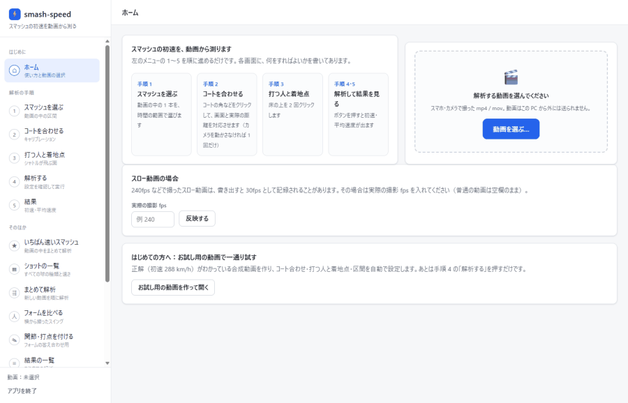

左のメニューは 3 つに分かれています。

| まとまり | 画面 | すること |
|---|---|---|
| はじめに | 「ホーム」 | 動画を開く・お試し用の動画を作る |
| 解析の手順 | 「スマッシュを選ぶ」→「コートを合わせる」→「打つ人と着地点」→「解析する」→「結果」 | スマッシュ 1 本を詳しく測る（[4 章](#4-スマッシュ-1-本の速さを測る)） |
| そのほか | 「いちばん速いスマッシュ」「ショットの一覧」「まとめて解析」「フォームを比べる」「関節・打点を付ける」「結果の一覧」「記録の推移」「研究ツール」「開発エージェント」「設定」 | 動画全体をまとめて見る・記録を見る など |

済んだ手順には、メニューの番号の所に ✓ が付きます。

### 動画を開く

「ホーム」の「動画を選ぶ…」で動画のファイルを選びます。左下に「動画：（名前）」と出れば開けています。
スロー動画（例：240fps で撮って 30fps で書き出したもの）は、「スロー動画の場合」に撮影したときの fps を入れて「反映する」を押します。

### まずお試し用の動画で一通り試す

はじめての方は、「ホーム」の「はじめての方へ：お試し用の動画で一通り試す」の「お試し用の動画を作って開く」を押してください。
正解（初速 288 km/h）が分かっている動画を作り、コート合わせ・打つ人と着地点・区間まで自動で済ませて「解析する」の画面を開きます。
「▶ 解析する」を押すと、1 分ほどで「結果」に初速が出ます（このときは 289 km/h でした）。

---

## 2. 撮り方

スマホで撮った動画で使えます。どの撮り方でも共通の大事なこと：

- **三脚などで固定し、ズームしない**（コート合わせを同じカメラ位置の別の動画に使い回せます）。
- **音も一緒に録る**（打った音から、打った瞬間が決まります）。
- コートのライン（できれば四隅と、ネットの支柱の根元・上の端）が映るようにする。
- 明るい所で、シャッターを速く（暗いとシャトルが薄い線になり、見つかりにくくなります）。
- 0.5 倍の超広角より、1 倍のレンズの方がゆがみが少なく、合わせやすい。

### 基礎打ち（ドライブ・プッシュ・スマッシュとレシーブなど）

- ネットの近くの横から、少し斜めにコート全体が入るように撮ります。手前の人が画面の端で少し切れても大丈夫です。
- 1 つの練習を続けて撮ると、続いた本数・テンポ・ばらつきを比べやすくなります。動画ごとに何の練習かを覚えておいてください。

### 試合・ゲーム練習

- コートの横の高い所（2〜4 m）から、コートの長い向き全体が入るように撮ると、速さがいちばん正確です。
- 低い所や角から撮るときは、奥のベースラインまで映るようにします。

### 側方のフォーム（「フォームを比べる」用）

- 打つ人の横（ラケットを持つ腕の側）、6〜8 m 離れて、腰の高さ（1.2〜1.5 m）から水平に撮ります。
- 打つ向きとカメラの向きが直角になるように置きます。体全体とラケットが画面に入るようにします。

---

## 3. コートを合わせる

速さを m や km/h で出すには、画面のどこがコートのどこかをアプリに教える必要があります（**カメラの位置を変えなければ 1 回だけ**）。
左のメニューの「コートを合わせる」を開きます。

1. **「カメラと打つ人の位置を教えてください」**：上から見たコートの図で、カメラを置いた場所と、打つ人の側の半面をクリックし、
   「次へ：点をクリック →」を押します。
2. **点を置く**：赤く点滅する点の名前（例：手前・右のショートサービスラインの端）と、線のどこを狙うかの図が出るので、その通りに
   動画の上をクリックします。映っていない点は「映っていない → とばす」（キーボードの S）。最低 6 点（できれば 8 点以上）置くと
   「確認へ →」が押せます。マウスホイールで拡大、右ドラッグで移動、クリックする所にはルーペが出ます。
   - 楽をする方法 その 1：右下の図でコートの角を選び、動画の上でその角を **1 点だけ** クリックして自動で合わせる（20〜40 秒）。
   - その 2：床の角を 4 点（離れた所を、だいたいでよい）クリックして、残りの点を自動で合わせる（10 秒ほど。自動で置いた点は水色）。
   - その 3：選手でラインが隠れていないコマで「クリックなしで候補を出す」（1〜1.5 分）。候補を押すと黄色の線で重なるので、
     ラインに重なっているものを選んで「この候補を使う（確認へ）」。どれも合わなければ「候補を閉じる」で、上のどちらかに戻ります。
3. **「黄色い線が、実際のコートのラインに重なっていますか？」**：重なっていれば「保存して次へ →」。ずれていたら「← 点を直す」で
   ずれた点だけ選んでクリックし直します。

一度保存したカメラ位置では、次から「このカメラ位置のコート合わせは済んでいます」と出るので「このまま使う（次へ）」を押すだけです。
ほかの動画で作った合わせは「別のファイルを読み込む…」で読み込めます。

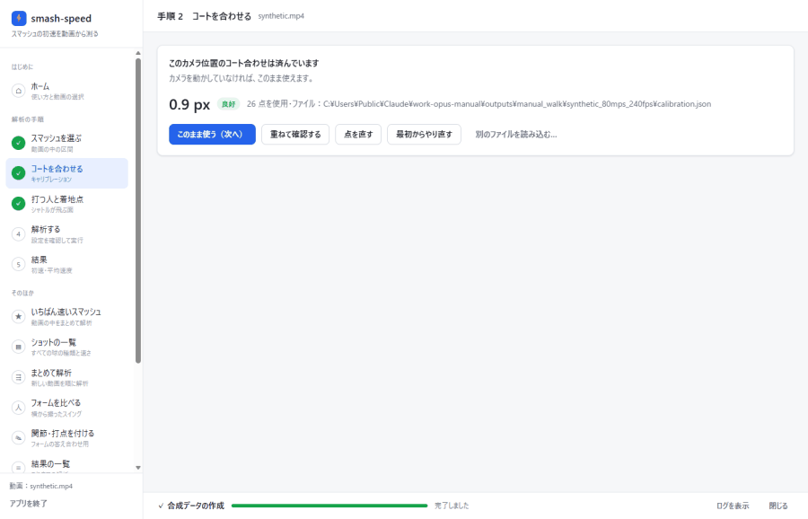

---

## 4. スマッシュ 1 本の速さを測る

左のメニューの「解析の手順」を上から順に進めます。

1. **「スマッシュを選ぶ」**：「打球音を探す」を押すと、打った音の所に時間軸のオレンジの線が出ます。動画を動かして
   「今の位置を開始に」「今の位置を終了に」で、スマッシュ 1 本の前後を選びます（「▶ この区間を再生」で確かめられます）。
2. **「コートを合わせる」**：[3 章](#3-コートを合わせる)。
3. **「打つ人と着地点」**：動画の上で、打つ人の足元と、シャトルが落ちた所の床をクリックします
   （「① を選手の立ち位置から入れる」でも入ります）。
4. **「解析する」**：「準備の確認」が緑のチェックになっていれば「▶ 解析する」。進み具合は画面の下に出ます（4K で 1〜3 分）。

   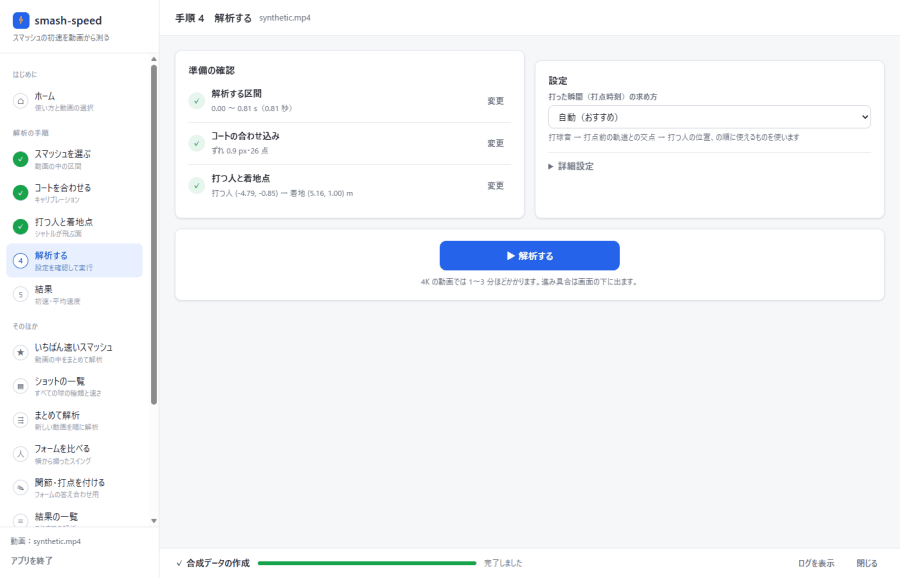

5. **「結果」**：初速（打った直後の速さ）・平均の速さ・落ちる直前の速さと、「結果の信頼性」（画面の上のずれ・使ったコマの数・
   打った瞬間の決め方）が出ます。「結果のフォルダを開く」で、結果を描き込んだ動画も見られます。

   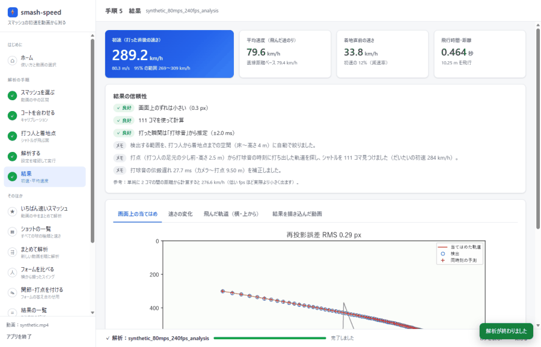

### 動画の中でいちばん速いスマッシュを探す

「いちばん速いスマッシュ」では、動画の中のスマッシュをまとめて解析し、速い順に並べます（コート合わせが済んでいること）。

1. 「① 候補を探す」：打った音ごとに、だいたいの初速を出します（2 分の動画で 1〜2 分）。
2. 速そうな候補に最初から印が付きます。「確認する」で、打つ人の足元・落ちた所を直せます。
3. 「③ 選んだ 〇 個を詳しく解析する」：速い順に並びます。1 位と 2 位の差が誤差の範囲なら、そう表示されます。

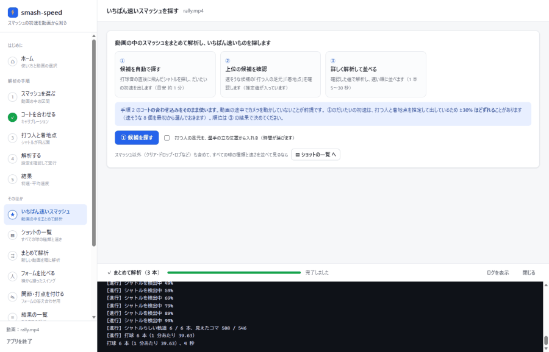

---

## 5. ショットの一覧（すべての球）

「ショットの一覧」では、動画の中のすべてのショット（スマッシュ・クリア・ドロップ・ドライブ・ロブ・ネット・プッシュ・サーブ）を、
種類と初速つきで並べます（コート合わせが済んでいること）。

1. 「動画全体」か「区間を決める」を選びます。選手の動きも見たいときは「選手の立ち位置も記録する（時間が延びます）」に印を付けます。
2. 「解析を始める」を押します。進み具合は画面の下に出ます（4K 30fps の 20 秒で約 1 分。選手の立ち位置つきは長くなります）。

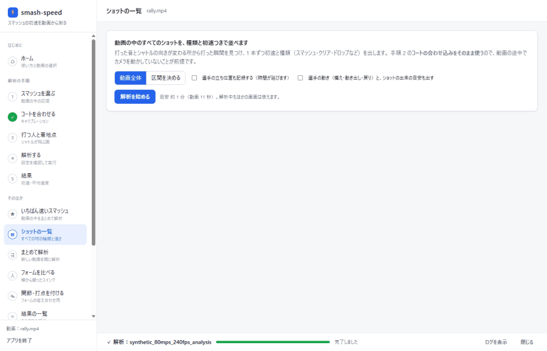

3. できあがると、「種類ごとの本数と速さ」のカードと、表が出ます。カードを押すとその種類だけになり、表は時刻の順・速い順に並べ替えられます。
4. 表の行を押すと、その場面にシャトルと計算した飛び方を重ねた画像と、上から見た飛び方が出ます。「▶ 再生」「◀ 前のコマ」「次のコマ ▶」で
   見返せます。
5. 種類が違っていたら、正しい種類を選んでおけます（次の解析のための答えとして残ります）。打っていない所がショットになっていたら
   「打球ではない」を選びます。

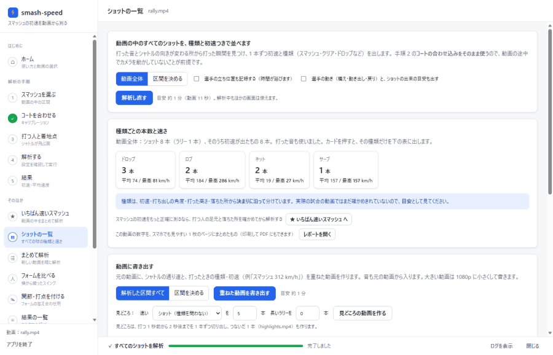

「動画に書き出す」では、元の動画にシャトルの通り道と種類・初速を重ねた動画（「重ねた動画を書き出す」）と、速いスマッシュや長いラリーだけを
切り出した見どころの動画（「見どころの動画を作る」）を作れます。

---

## 6. 基礎打ちの解析

**準備中です。** コート合わせなしで、基礎打ちの続いた本数・テンポ・ばらつきを出す画面（「基礎打ちの解析」）は、いま作っています。
今は、[「まとめて解析」](#7-新しい動画をまとめて解析する)で基礎打ちの解析（打った数と時刻）を作っておけます（結果を見る画面はこれからです）。コート合わせをしてから「ショットの一覧」を使うと、1 本ずつの種類と速さが見られます。

---

## 7. 新しい動画をまとめて解析する

「まとめて解析」では、動画のフォルダの中で、まだ解析していない動画を選んで、1 本ずつ続けて解析します。
撮った動画をフォルダに入れておき、まとめて押しておく使い方です（押したときだけ動きます）。

1. 「解析する動画のフォルダ」の「選ぶ…」で、動画を入れたフォルダを選びます（スマホからは、デスクトップのフォルダを選びます）。
2. 表に動画が並びます。「基礎打ちの解析」「コート合わせ」「ショットの一覧」の欄に、済み・まだが出ます。
   まだのものには最初から印が付いています（「まだのものを全部選ぶ」でも付きます）。
3. 「選んだ動画を順に解析する」を押します。1 本ずつ、
   - 基礎打ちの解析（打った数と時刻。コート合わせはいりません。結果は保存先の `drills` フォルダに入ります）
   - その動画のコート合わせを保存してあれば、ショットの一覧

   を作ります。進み具合は画面の下に出ます（1 本あたり、動画の長さの 1.5〜2 倍ほど）。
4. 止めるときは、画面の下の「中止」を押します。もう一度「選んだ動画を順に解析する」を押すと、**終わっていない動画から続けます**
   （途中で止めた動画は、その動画の最初からやり直します）。
5. うまくいかなかった動画があっても次の動画へ進み、最後に「止めたか、うまくいかなかった動画があります」と出ます。「ログを表示」で理由が見られます。

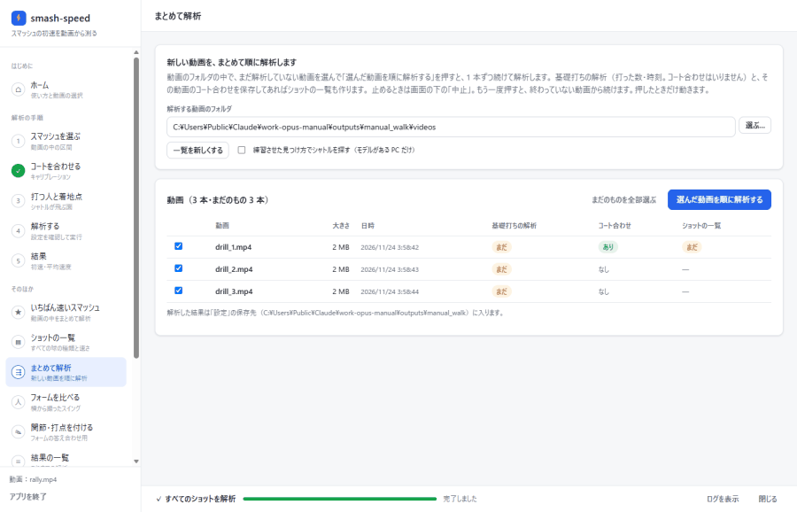

終わると、表の欄がすべて「済み」になり、選ぶ印が消えます。

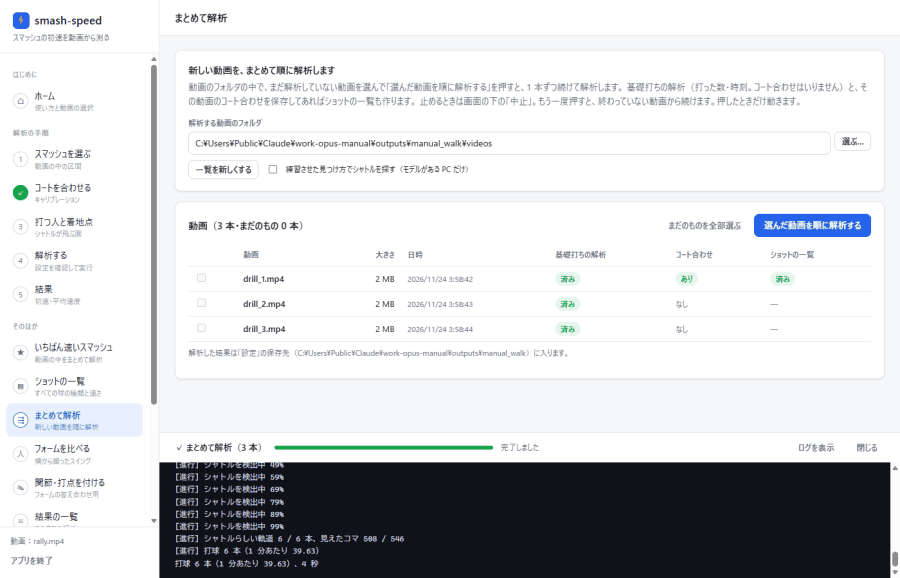

スマホから使うときも同じ画面です。押した後はスマホを閉じても、デスクトップで続きます。

---

## 8. フォームを比べる

「フォームを比べる」では、[側方から撮った](#側方のフォームフォームを比べる用) スイングの形を数字にします。

1. 横から撮った動画を開き、「「（動画の名前）」を解析する」を押します（関節の位置を画面から探すので、少し時間がかかります）。
2. 「速い球と遅い球を選ぶ」で 2 本を選ぶと、肘の角度・体のひねりなどの違いが並びます。「▶ 動かす」で 2 本のスイングを並べて動かせます。

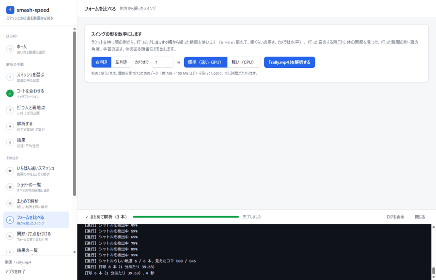

「関節・打点を付ける」は、関節の正しい位置と、打った瞬間のコマを手で付ける画面です（フォームの解析の答え合わせ用。ふだんは使いません）。

---

## 9. レポートと記録の推移

- **レポート**：「ショットの一覧」の「レポートを開く」で、その動画の数字（種類ごとの本数・速さ・ラリー・選手の動き）を 1 枚にまとめた
  ページが別のタブで開きます。ブラウザの「印刷」→「PDF に保存」で PDF にもできます。
- **「記録の推移」**：これまでに作ったショットの一覧をすべて集め、撮った日ごとの速さと種類の割合を出します。新しく解析したら
  「作り直す」を押します。「別のタブで開く」で大きく見られます。

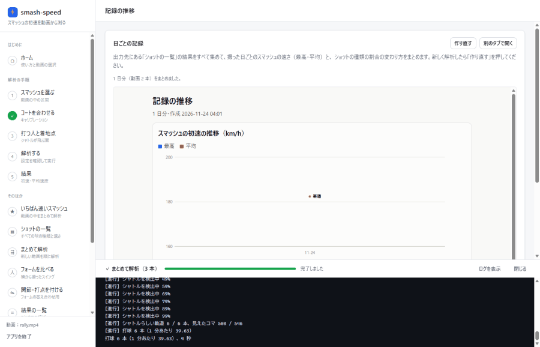

- **「結果の一覧」**：これまでのスマッシュの解析の結果がすべて並びます。「集計表（CSV）を作る」で表計算ソフトに読み込めます。

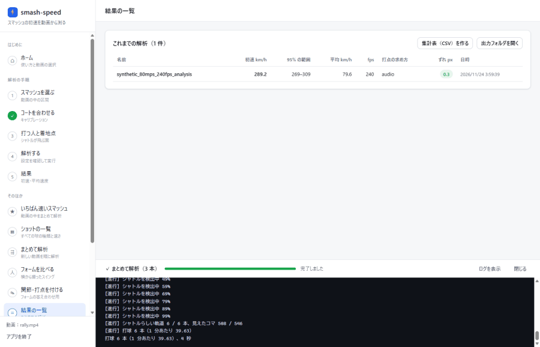

---

## 10. スマホから使う

解析は家のデスクトップで動かし、画面だけをスマホやノート PC から使えます。インターネットには公開せず、自分の端末どうしだけを
つなぐ「Tailscale」（個人なら無料）を使います。

1. デスクトップ・スマホのそれぞれに Tailscale を入れ、同じアカウントでログインします。
2. デスクトップで `smash-speed-remote.bat` をダブルクリックします。はじめてのときだけ合言葉（8 文字以上）を決めます。
   最後に、スマホで開くアドレス（`http://100.x.x.x:8765/`）が出ます。
3. スマホで Tailscale をオンにして、そのアドレスをブラウザで開き、合言葉でログインします（30 日間はログインしたまま）。

スマホからのときの違い：

- 動画は「デスクトップの動画を選ぶ…」（デスクトップのフォルダから選ぶ）か、「この端末の動画を送る…」（スマホで撮った動画を送る）で開きます。
- 解析はデスクトップで動くので、スマホを閉じても止まりません。あとで開き直せば結果が見られます。
- 左下は「アプリを終了」の代わりに「ログアウト」です。アプリを止めるのはデスクトップで行います。
- 2 台で同時に操作しないでください（開いている動画などは全部の端末で同じです）。

---

## 11. そのほかの画面

- **「設定」**：結果を保存する場所と、詳しい設定のファイル（ふだんは変えなくて大丈夫です）。

  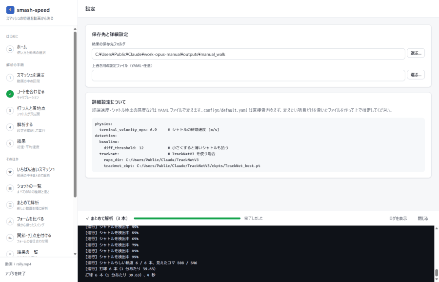

- **「研究ツール」**：シャトルの位置の答えを手で付ける・練習用の合成の動画を作る・精度を確かめる、など（開発用）。
- **「開発エージェント」**：アプリの機能を自動で少しずつ増やす仕組みの様子と、「あなたへの質問」が見られます（開発用）。

---

## 12. 困ったとき

### コート合わせが外れる（黄色の線がラインに重ならない）

- 選手でラインが隠れていないコマに動かしてから、合わせ直してください。
- 点は、ラインの **外側の角** を狙います（線の図のとおり）。遠くの点ほどずれやすいので、ルーペで拡大して置きます。
- ずれた点だけを選んで置き直すのが早道です。どうしても合わないときは「最初からやり直す」。
- 0.5 倍の超広角で撮った動画はゆがみが大きく、合いにくいことがあります。次からは 1 倍で撮ってください。
- 「クリックなしで候補を出す」は、ラインを 1 本取り違えた候補が上に来ることがあります。必ず黄色の線を見て選んでください。

### シャトルが見つからない・速さが出ない

- 「結果」の「結果の信頼性」で、使ったコマの数が少ない・画面の上のずれが大きいときは、シャトルがうまく見えていません。
- 暗い・シャッターが遅い動画ではシャトルが薄い線になります。明るい所で撮ってください。
- 背景が白い所（白い壁・照明）ではシャトルが見えにくくなります。カメラの向きを変えて、背景が暗く単調になるようにします。
- 打った直後が選手の体やラケットで隠れていると、その球の速さは出ないことがあります。
- 「ショットの一覧」で「軌道が検出と合わない」と出たショットは、別の物（ほかのコートのシャトルなど）を拾っています。速さは出しません。

### 時間がかかる

- 4K の動画は時間がかかります。「区間を決める」で必要な所だけを解析すると早くなります。
- 「選手の立ち位置も記録する」に印を付けると長くなります（選手を探すため）。
- 処理の途中は画面の下に進み具合が出ます。「中止」でいつでも止められます。スマホを閉じても、デスクトップでは続きます。

### そのほか

- 「ほかの処理が実行中です」と出たら、画面の下の処理が終わるのを待つか、「中止」を押してください（同時に 1 つだけ動きます）。
- 動画が開けないときは、ファイルの名前に特殊な記号がないか、スマホから送った途中で切れていないかを確かめてください。
